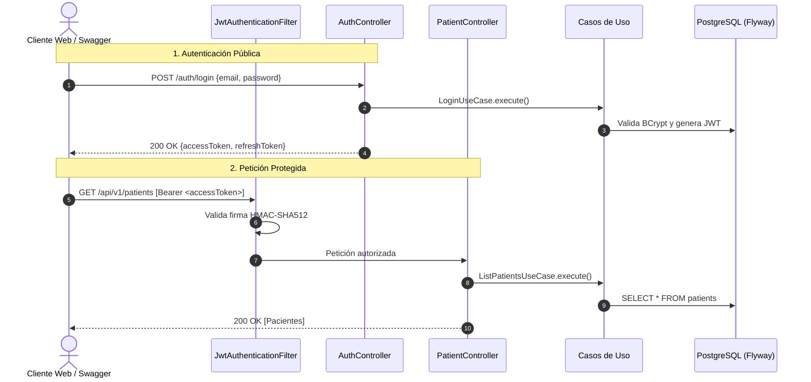

# 🏥 Telemedicina & Triaje IA - Sistema Completo con Spring Security 6, JWT, DDD y PostgreSQL

[](https://openjdk.org/)
[](https://spring.io/projects/spring-boot)
[](https://spring.io/projects/spring-security)
[](https://jwt.io/)
[](https://www.postgresql.org/)
[](https://flywaydb.org/)
[](https://martinfowler.com/tags/domain%20driven%20design.html)

Plataforma de **Telemedicina, Salud Mental y Triaje Clínico Asistido por Inteligencia Artificial**. Implementa una **Arquitectura Hexagonal (DDD Multi-Módulo)** estricta, seguridad basada en **Spring Security 6** con **Tokens JWT Stateless**, persistencia relacional completa (**35+ tablas del diagrama ERD**) en **PostgreSQL**, y control versionado de base de datos con **Flyway**.

---

## 📚 1. Documentación Técnica Detallada (`docs/`)

Para una revisión en profundidad de cada capa, consulte la documentación modularizada en la carpeta [`docs/`](./docs/):
* 🗄️ [**docs/DATABASE_SETUP.md**](./docs/DATABASE_SETUP.md): Configuración de PostgreSQL y migración de las 35+ tablas con Flyway (`V1` a `V6`).
* 🔐 [**docs/JWT_AUTHENTICATION_SYSTEM.md**](./docs/JWT_AUTHENTICATION_SYSTEM.md): Flujo de tokens, claims, renovación y seguridad stateless.
* 📖 [**docs/SWAGGER_OPENAPI_SETUP.md**](./docs/SWAGGER_OPENAPI_SETUP.md): Configuración de OpenAPI 3 y endpoints interactivos.
* 🏛️ [**docs/ARCHITECTURE_DDD.md**](./docs/ARCHITECTURE_DDD.md): Puertos, adaptadores, entidades de dominio y casos de uso desacoplados.

---

## 📐 2. Arquitectura del Sistema (Multi-Módulo DDD)

```
telemedicina-security/
├── domain/                      # Reglas de negocio puras (User, Role, Patient, Puertos de Repositorio)
├── application/                 # Casos de uso (Login, Register, RefreshToken, RegisterPatient) y DTOs
├── infrastructure/              # Adaptadores de entrada (REST), salida (JPA PostgreSQL), Spring Security 6 y Flyway
├── docs/                        # Documentación técnica modularizada
└── pom.xml                      # Reactor Maven Padre
```

### Flujo de Seguridad y Ejecución


---

## 🗄️ 3. Modelo de Base de Datos (Migraciones Flyway)

El esquema completo cuenta con más de 35 tablas con claves primarias `UUID` y columna `JSONB` para mensajería:
* **`V1__catalogs_and_geography.sql`**: Extensión `uuid-ossp`, países, regiones, ciudades y 18 catálogos clínicos y de IA.
* **`V2__security_tables.sql`**: `roles`, `users`, `user_roles`, `refresh_tokens`.
* **`V3__identity_and_actors.sql`**: `patients` y `professionals` (vinculados opcionalmente con `users`), contactos y alergias.
* **`V4__clinical_core.sql`**: `clinical_records`, `encounters`, `mental_status_exams`, `risk_assessments`, planes de tratamiento.
* **`V5__chat_and_ai_system.sql`**: `provider_models_ai`, `ai_models`, `chat_conversations`, `chat_messages` (JSONB), métricas de IA y escalamientos.
* **`V6__seed_data.sql`**: Semillas iniciales de roles (`ADMIN`, `USER`, `PROFESSIONAL`, `PATIENT`), catálogos y usuario administrador inicial.

---

## 🚀 4. Guía de Puesta en Marcha

### Prerrequisitos
* **Java 21 o superior**
* **Maven 3.9+**
* **PostgreSQL** en `localhost:5432` con la base de datos creada:
  ```bash
  psql -U postgres -c "CREATE DATABASE telemedicina_security_db;"
  ```

### Compilación y Construcción
```bash
mvn clean install
```

### Ejecutar la Aplicación
```bash
mvn spring-boot:run -pl infrastructure -Dspring-boot.run.profiles=dev
```
*El servicio iniciará en `http://localhost:8080` aplicando automáticamente todas las migraciones Flyway.*

---

## 📖 5. Documentación Interactiva (Swagger UI)

Acceda a la interfaz interactiva desde su navegador:
👉 **[http://localhost:8080/swagger-ui/index.html](http://localhost:8080/swagger-ui/index.html)**

### Credenciales demo precargadas:
* **Email:** `admin@telemedicina.com`
* **Contraseña:** `Password123!`
