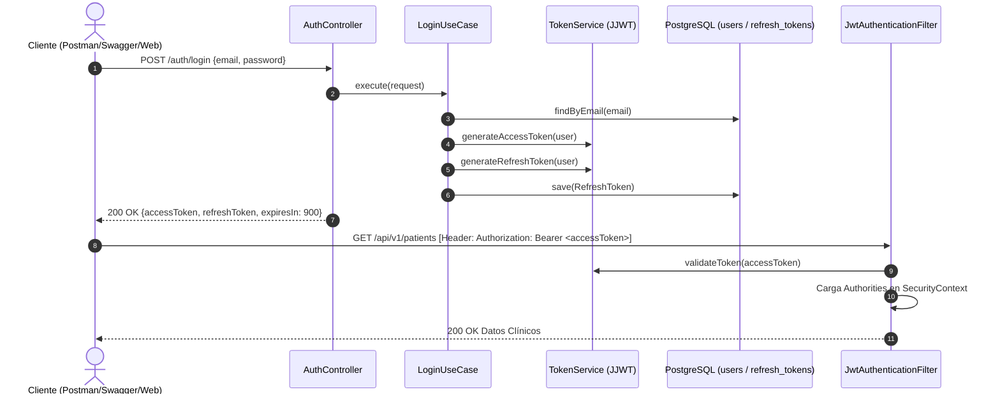

# 🔐 Sistema de Autenticación JWT y Spring Security 6

## 1. Arquitectura de Seguridad
El sistema utiliza una arquitectura de seguridad **Stateless** basada en tokens JSON Web Token (JWT). No se almacena sesión HTTP en memoria ni en servidor (`SessionCreationPolicy.STATELESS`), lo que garantiza escalabilidad horizontal.



---

## 2. Parámetros de Configuración del Token
Definidos en `application.yml`:
* **Algoritmo:** HMAC-SHA512 (`HS512`).
* **Secreto:** `404E635266556A586E3272357538782F413F4428472B4B6250645367566B5970`
* **Expiración Access Token:** `900000 ms` (15 minutos).
* **Expiración Refresh Token:** `604800000 ms` (7 días).

---

## 3. Endpoints de Autenticación

### A. Registro (`POST /auth/register`)
* **Acceso:** Público (`permitAll`)
* **Payload:**
  ```json
  {
    "email": "doctor@telemedicina.com",
    "password": "Password123!"
  }
  ```

### B. Inicio de Sesión (`POST /auth/login`)
* **Acceso:** Público (`permitAll`)
* **Respuesta:**
  ```json
  {
    "accessToken": "eyJhbGciOiJIUzUxMiJ9...",
    "refreshToken": "202e3d2b-cfca-4d46-bd8e-ac9740032174",
    "tokenType": "Bearer",
    "expiresIn": 900
  }
  ```

### C. Renovación de Token (`POST /auth/refresh`)
* **Acceso:** Público
* **Payload:**
  ```json
  {
    "refreshToken": "202e3d2b-cfca-4d46-bd8e-ac9740032174"
  }
  ```

### D. Perfil de Usuario Autenticado (`GET /auth/me`)
* **Acceso:** Requiere cabecera `Authorization: Bearer <accessToken>`
* **Respuesta:** Objeto usuario con UUID y roles asignados.
